# DOSW_ParcialT2_JuanAlvarez

## Índice

1. [Datos del estudiante](#1-datos-del-estudiante)
2. [Descripción del proyecto](#2-descripción-del-proyecto)
3. [Despliegue](#3-despliegue)
4. [Estructura del proyecto](#4-estructura-del-proyecto)
5. [Tecnologías y dependencias](#5-tecnologías-y-dependencias)
6. [Configuración y variables de entorno](#6-configuración-y-variables-de-entorno)
7. [Cómo ejecutar](#7-cómo-ejecutar)
8. [Pruebas](#8-pruebas)
9. [Docker](#9-docker)
10. [CI/CD](#10-cicd)
11. [Herramientas de modelado y diseño (evidencias)](#11-herramientas-de-modelado-y-diseño-evidencias)

---

## 1. Datos del estudiante

| Campo | Valor |
|---|---|
| Nombre completo | Juan Nicolás Álvarez Muñoz |
| Grupo | 2 |
| Profesor agregado al repositorio | ✔ |

## 2. Descripción del proyecto

Servicio REST desarrollado con Spring Boot para el parcial práctico del segundo tercio de DOSW.
El proyecto sigue una arquitectura MVC por capas (controller, core y persistence), usa MongoDB como
base de datos, Spring Security con JWT para la autenticación y Swagger para documentar la API.
Se empaqueta en una imagen Docker y se despliega automáticamente en Azure App Service mediante GitHub Actions.

## 3. Despliegue

| Recurso | URL |
|---|---|
| Servicio en Azure | https://dosw-parcialt2-juanalvarez.azurewebsites.net |
| Health | https://dosw-parcialt2-juanalvarez.azurewebsites.net/api/v1/health |
| Swagger | https://dosw-parcialt2-juanalvarez.azurewebsites.net/swagger-ui/index.html |

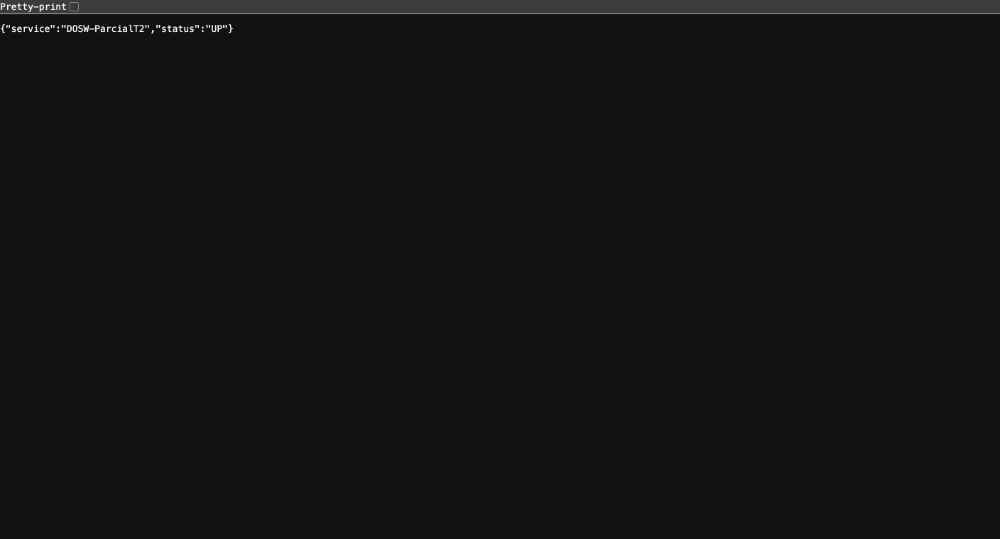

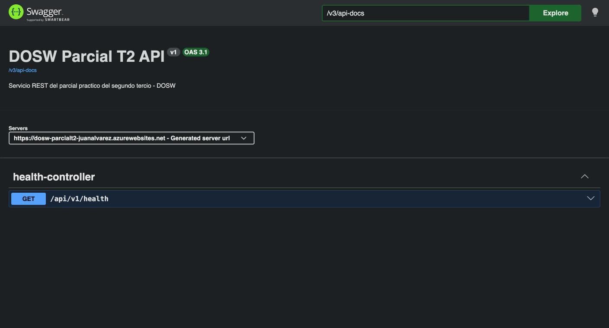

## 4. Estructura del proyecto

```
DOSW_ParcialT2_JuanAlvarez/
├── docs/
│   ├── uml/
│   └── images/
├── src/
│   ├── main/
│   │   ├── java/edu/dosw/parcial/
│   │   │   ├── controller/
│   │   │   │   ├── dtos/
│   │   │   │   │   ├── request/
│   │   │   │   │   └── response/
│   │   │   │   ├── mappers/
│   │   │   │   └── handlers/
│   │   │   ├── core/
│   │   │   │   ├── services/
│   │   │   │   ├── models/
│   │   │   │   ├── validators/
│   │   │   │   └── utils/
│   │   │   ├── persistence/
│   │   │   │   ├── entities/
│   │   │   │   ├── repositories/
│   │   │   │   └── mappers/
│   │   │   ├── config/
│   │   │   └── main/
│   │   └── resources/
│   │       └── application.yaml
│   └── test/
│       ├── java/edu/dosw/parcial/
│       │   ├── controller/
│       │   ├── core/
│       │   └── persistence/
│       └── resources/
├── .github/workflows/ci-cd.yml
├── Dockerfile
├── .dockerignore
├── mvnw / mvnw.cmd / .mvn/
├── pom.xml
├── .gitignore
└── README.md
```

| Paquete / carpeta | Responsabilidad |
|---|---|
| `docs/uml` | Diagramas fuente (draw.io / Lucidchart / Miro). |
| `docs/images` | Exportes PNG/SVG y capturas usadas como evidencia en este README. |
| `controller` | Controladores REST que exponen los endpoints de la API. |
| `controller/dtos/request` | DTOs de entrada con sus validaciones. |
| `controller/dtos/response` | DTOs de salida que se devuelven al cliente. |
| `controller/mappers` | Mapper IN: RequestDTO → Dominio y Dominio → ResponseDTO. |
| `controller/handlers` | `GlobalExceptionHandler` para el manejo centralizado de errores. |
| `core/services` | Lógica de negocio. |
| `core/models` | Objetos de dominio. |
| `core/validators` | Reglas de validación del negocio. |
| `core/utils` | Utilidades compartidas. |
| `persistence/entities` | Clases `@Document` de MongoDB. |
| `persistence/repositories` | Interfaces `MongoRepository`. |
| `persistence/mappers` | Mapper OUT: Dominio ↔ Document. |
| `config` | Configuración de seguridad (`SecurityConfig`) y Swagger (`SwaggerConfig`). |
| `main` | Clase principal anotada con `@SpringBootApplication`. |

## 5. Tecnologías y dependencias

| Tecnología | Versión | Para qué se usa |
|---|---|---|
| Java | 21 | Lenguaje del proyecto. |
| Spring Boot | 3.5.16 | Framework base del servicio. |
| Spring Web | (Spring Boot) | Construcción de la API REST. |
| Spring Data MongoDB | (Spring Boot) | Persistencia en MongoDB. |
| Spring Validation | (Spring Boot) | Validación de DTOs. |
| Spring Security | (Spring Boot) | Seguridad de los endpoints. |
| JJWT | 0.12.7 | Generación y validación de tokens JWT. |
| springdoc-openapi | 2.8.17 | Documentación de la API con Swagger UI. |
| Lombok | (Spring Boot) | Reducción de código repetitivo y logs con `@Slf4j`. |
| MapStruct | 1.6.3 | Mappers entre DTOs, dominio y documentos. |
| JUnit 5 + Mockito | (Spring Boot) | Pruebas unitarias. |
| Jacoco | 0.8.15 | Reporte de cobertura de pruebas. |
| SonarQube (sonar-maven-plugin) | 5.8.0.7211 | Análisis estático de calidad del código. |
| Maven (Wrapper) | 3.9.11 | Construcción del proyecto sin instalar Maven (`mvnw`). |
| Docker | — | Contenerización del servicio. |
| GitHub Actions | — | Pipeline de CI/CD. |
| Azure App Service | — | Despliegue del contenedor. |

## 6. Configuración y variables de entorno

| Variable | Descripción | Ejemplo |
|---|---|---|
| `MONGODB_URI` | Cadena de conexión a MongoDB. Si no se define se usa la base local. | `mongodb://localhost:27017/dosw_parcial` |
| `JWT_SECRET` | Secret en Base64 para firmar los JWT (mínimo 44 caracteres). | `<secret_base64>` |
| `PORT` | Puerto del servidor (por defecto 8080). | `8080` |
| `WEBSITES_PORT` | Puerto al que Azure enruta el tráfico del contenedor. | `8080` |

Ninguna credencial se sube al repositorio: `.env` y `*.p12` están en el `.gitignore`.

## 7. Cómo ejecutar

### 7.1 Preparar el entorno en un PC nuevo

**Herramientas necesarias**

| Herramienta | Versión | Verificar con |
|---|---|---|
| Git | cualquiera reciente | `git --version` |
| JDK | **21** (Temurin recomendado) | `java -version` |
| Docker Desktop | cualquiera reciente | `docker --version` |
| IntelliJ IDEA (opcional) | cualquiera reciente | — |
| GitHub CLI (opcional) | cualquiera reciente | `gh --version` |

> ⚠️ **Usar JDK 21.** Con versiones más nuevas del JDK (por ejemplo 27) Lombok falla al compilar con
> `ExceptionInInitializerError: com.sun.tools.javac.tree.EndPosTable`. Si hay varios JDK instalados, `JAVA_HOME`
> debe apuntar al 21.

No hace falta instalar Maven: el proyecto incluye el Maven Wrapper (`mvnw` / `mvnw.cmd`), que descarga Maven 3.9.11 la primera vez.

**1. Clonar el repositorio y configurar la identidad de Git**

```bash
git clone https://github.com/JUANNICOLASA/DOSW_ParcialT2_JuanAlvarez.git
cd DOSW_ParcialT2_JuanAlvarez
git checkout develop
git config user.name "JUANNICOLASA"
git config user.email "juan.amunoz@mail.escuelaing.edu.co"
```

**2. Definir el secret JWT para desarrollo local**

En local se puede usar cualquier valor Base64 de mínimo 44 caracteres (no tiene que ser el de Azure).

macOS / Linux:

```bash
export JWT_SECRET=$(openssl rand -base64 48)
```

Windows (PowerShell):

```powershell
$bytes = New-Object byte[] 48; [Security.Cryptography.RandomNumberGenerator]::Create().GetBytes($bytes)
$env:JWT_SECRET = [Convert]::ToBase64String($bytes)
```

La variable solo dura mientras la terminal esté abierta.

**3. Levantar MongoDB local**

Con Docker Desktop abierto:

```bash
docker run -d -p 27017:27017 --name mongo-parcial mongo:7
```

Si el contenedor ya existe (por ejemplo, después de reiniciar el PC): `docker start mongo-parcial`.

**4. Compilar y ejecutar las pruebas**

```bash
./mvnw clean verify          # macOS / Linux
.\mvnw.cmd clean verify      # Windows
```

Debe terminar en `BUILD SUCCESS`. El reporte de Jacoco queda en `target/site/jacoco/index.html`.

**5. Ejecutar el servicio**

```bash
./mvnw spring-boot:run       # macOS / Linux
.\mvnw.cmd spring-boot:run   # Windows
```

Verificar en el navegador:

- http://localhost:8080/api/v1/health → `{"status":"UP","service":"DOSW-ParcialT2"}`
- http://localhost:8080/swagger-ui/index.html → carga Swagger

**6. Abrir el proyecto en IntelliJ IDEA**

1. *File → Open* y seleccionar el `pom.xml` → *Open as Project*.
2. *File → Project Structure → Project → SDK*: seleccionar **21** (si no aparece, *Add SDK → Download JDK → Temurin 21*).
3. *Settings → Build, Execution, Deployment → Compiler → Annotation Processors*: marcar **Enable annotation processing** (Lombok y MapStruct).
4. Instalar el plugin de **Lombok** si IntelliJ lo sugiere.
5. Abrir `src/main/java/edu/dosw/parcial/main/ParcialApplication.java`, ejecutarla una vez y luego en *Run → Edit Configurations → Environment variables* agregar `JWT_SECRET=<valor_base64>`.

**7. Verificar el despliegue y el pipeline**

No se necesita configurar nada de Azure ni de Docker Hub en el PC nuevo: los secrets ya están en GitHub y la configuración en el App Service.

1. Hacer un cambio, commit y push a `develop`:
   ```bash
   git add .
   git commit -m "mensaje"
   git push origin develop
   ```
2. Revisar en GitHub → *Actions* que el workflow **CI/CD — DOSW Parcial T2** quede en verde (test → docker → deploy).
3. Abrir https://dosw-parcialt2-juanalvarez.azurewebsites.net/api/v1/health y https://dosw-parcialt2-juanalvarez.azurewebsites.net/swagger-ui/index.html. La primera petición puede tardar 30–60 s si el servicio estaba inactivo (plan gratuito).

### 7.2 Comandos rápidos

**Mongo local con Docker**

```bash
docker run -d -p 27017:27017 --name mongo-parcial mongo:7
```

**Local con Maven**

```bash
export JWT_SECRET=$(openssl rand -base64 48)
./mvnw spring-boot:run
```

**Local con Docker**

```bash
docker build -t dosw-parcial:local .
docker run -p 8080:8080 -e JWT_SECRET=<su_secret_base64> dosw-parcial:local
```

Luego abrir http://localhost:8080/api/v1/health y http://localhost:8080/swagger-ui/index.html.

## 8. Pruebas

```bash
./mvnw test        # macOS / Linux
.\mvnw.cmd test    # Windows
```

El reporte de cobertura de Jacoco queda en `target/site/jacoco/index.html`.

_Captura del resultado en verde:_


_Captura del reporte Jacoco:_

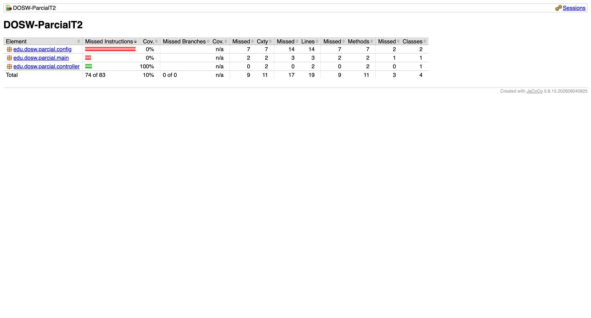

## 9. Docker

```bash
docker build -t dosw-parcial:local .
docker run -p 8080:8080 -e JWT_SECRET=<su_secret_base64> dosw-parcial:local
```

_Captura del contenedor corriendo:_


## 10. CI/CD

El pipeline está en `.github/workflows/ci-cd.yml` y se ejecuta con cada push a `main` y `develop`:

1. **test**: compila el proyecto y ejecuta las pruebas con `mvn verify`.
2. **docker**: construye la imagen y la publica en Docker Hub (`<usuario>/dosw-parcial-t2:latest`).
3. **deploy**: despliega la imagen en Azure App Service.

Secrets usados: `DOCKERHUB_USERNAME`, `DOCKERHUB_TOKEN`, `AZURE_CREDENTIALS`, `AZURE_WEBAPP_NAME`, `JWT_SECRET`.

_Captura del workflow en verde:_

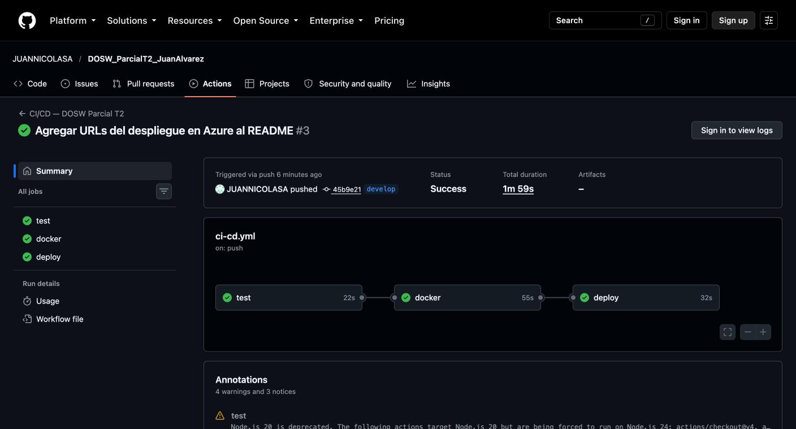

## 11. Herramientas de modelado y diseño (evidencias)

**Herramienta de modelado: Draw.io** (almacenamiento en Google Drive)

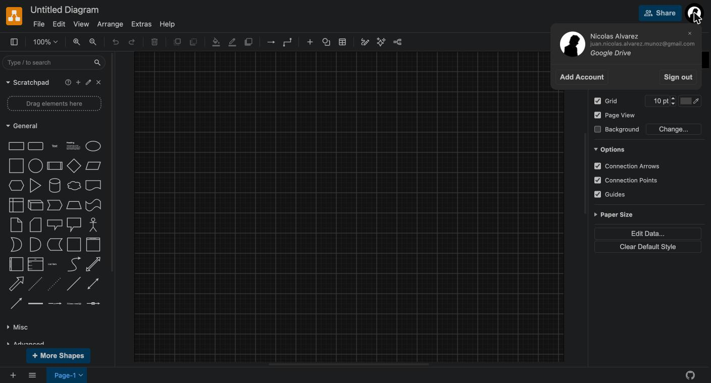

**Herramienta de diseño: Figma**

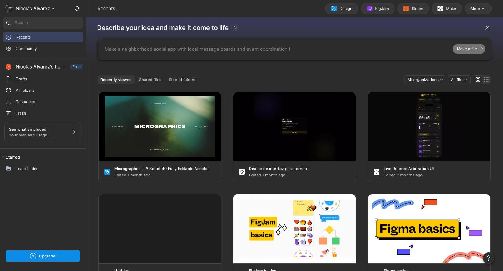

## Punto 1: Asignación del equipo de Producto - Definición del contrato de la API

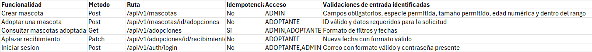

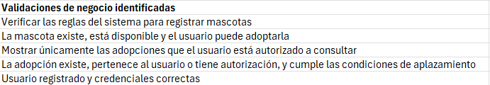

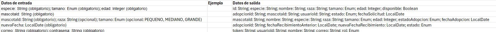

Ejemplos en doc: (docs/uml/Ejemplos-json.txt)

### Preguntas para la revisión con Producto:

#### ¿Cuál es la diferencia entre una validación de entrada y una validación de negocio? Seleccionen tres reglas del caso, incluyendo al menos una de cada tipo, y justifiquen su clasificación.

Las validaciones de entrada comprueban que los datos recibidos tengan el formato, tipo, rango o estructura esperados antes de procesarlos. Mientras que las validaciones de negocio comprueban que una operación cumpla las reglas del sistema y que su estado actual permita ejecutarla.

1- Crear una mascota - Validacion de entrada = La edad tiene que estar dentro de un rango  (Edad entre 0 y 360 meses) = Comprueba que el valor esté dentro del rango permitido.

2- Adoptar una mascota - Validacion de negocio = La mascota debe estar disponible = Depende del estado actual de la mascota.

3- Aplazar recibimiento de una mascota  - Validacion de entrada = La nueva fecha tambien tiene que estar dentro de un rango (. La nueva fecha debe ser posterior a la actual y no superar 15 días adicionales.) = Comprueba que la fecha cumpla las restricciones definidas para el dato recibido.

#### En Crear Mascota, ¿cómo debe responder la API si fallan varias condiciones? Expliquen qué error se informa y qué cambios deben evitarse.

La API deberia responder con un código HTTP 400 Bad Request e informar los errores de validación encontrados, indicando qué campos son inválidos y por qué.

Se deberia evitar crear las mascota directamente en la base de datos, y no se deberia modificar ningun dato existente.


## Punto 2: Asignación del equipo de Arquitectura - Distribución de las responsabilidades

Fuentes de los diagramas (draw.io): docs/uml/componentes-general.drawio, docs/uml/componentes-mvc.drawio y docs/uml/clases-dominio.drawio.

### Diagrama de componentes general

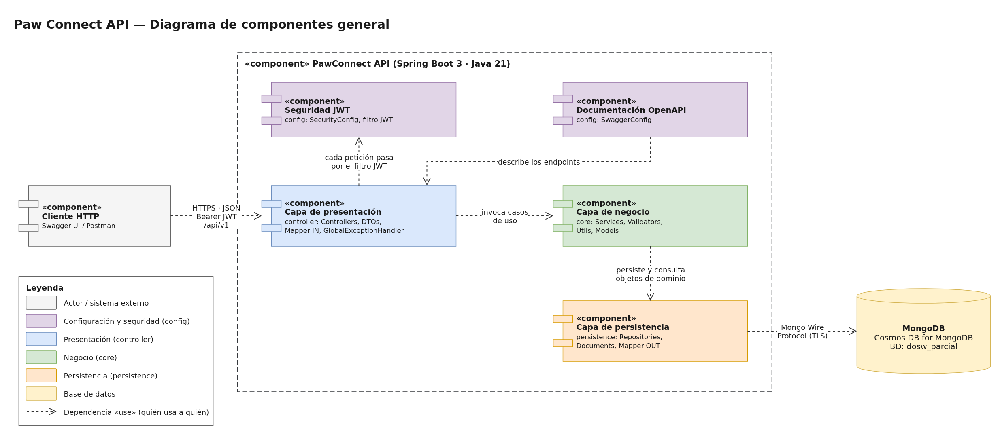

**Descripción.** Muestra la API de Paw Connect como un único componente desplegable que recibe peticiones HTTP de un cliente (Swagger UI o Postman) y guarda la información en MongoDB. Dentro de la API se distinguen tres capas (presentación, negocio y persistencia) y dos componentes de configuración (seguridad JWT y documentación OpenAPI).

**Justificación.**
- Se aplica una arquitectura por capas: cada capa solo depende de la siguiente (controller → core → persistence). Así, un cambio en la base de datos no obliga a modificar los controladores y un cambio en el contrato HTTP no afecta las reglas de negocio.
- La seguridad se representa como un componente independiente porque actúa antes de que la petición llegue a cualquier controlador: si el token no es válido, la petición no avanza.
- La capa de negocio y la de persistencia se comunican con objetos de dominio, no con DTOs ni con documentos de MongoDB. Esto mantiene el núcleo del sistema libre de detalles técnicos.
- Las flechas son dependencias «use»: indican qué componente necesita a cuál y en qué sentido viaja la solicitud.

### Diagrama de componentes específico (MVC)

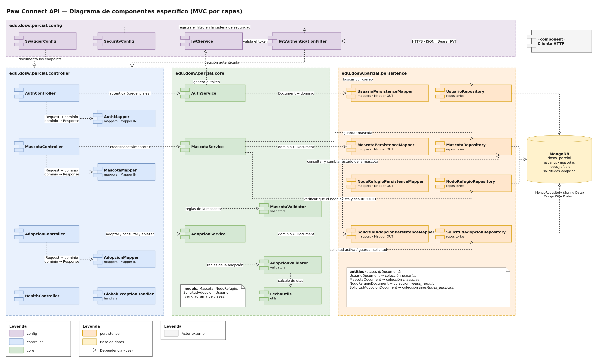

**Descripción.** Detalla los componentes de cada paquete del proyecto (config, controller, core y persistence) y cómo colaboran para atender los cinco casos de uso:

| Caso de uso | Controller | Service | Validator | Repositories |
|---|---|---|---|---|
| Iniciar sesión | AuthController | AuthService (+ JwtService) | — (validación del DTO) | UsuarioRepository |
| Crear una mascota | MascotaController | MascotaService | MascotaValidator | MascotaRepository, NodoRefugioRepository |
| Adoptar una mascota | AdopcionController | AdopcionService | AdopcionValidator | SolicitudAdopcionRepository, MascotaRepository |
| Consultar mascotas adoptadas | AdopcionController | AdopcionService | — | SolicitudAdopcionRepository |
| Aplazar recibimiento | AdopcionController | AdopcionService | AdopcionValidator | SolicitudAdopcionRepository |

**Justificación.**
- Un controller por recurso (autenticación, mascotas y adopciones). Los tres casos de adopción comparten el recurso solicitud de adopción, por eso quedan en AdopcionController y AdopcionService.
- Mapper IN en controller/mappers y Mapper OUT en persistence/mappers, uno por tipo de objeto, como se definió en la estructura del proyecto. El controller nunca ve un Document y el service nunca ve un DTO.
- Los validators concentran las reglas de negocio que pueden evaluarse con los datos ya cargados (compatibilidad, rango de fechas, cantidad de aplazamientos). El service se limita a coordinar el flujo, lo que facilita probar cada regla por separado.
- Un repository por colección. MascotaService usa NodoRefugioRepository para comprobar que el nodo de origen exista y sea de tipo REFUGIO (escenario E03). AdopcionService usa MascotaRepository para verificar la disponibilidad y cambiar el estado de la mascota a EN_PROCESO.
- GlobalExceptionHandler traduce las excepciones a los códigos HTTP de la matriz (400, 401, 403, 404, 409 y 422) en un solo lugar, para que todas las respuestas de error tengan el mismo formato.
- Todas las dependencias se inyectan por constructor, lo que permite reemplazarlas por mocks en las pruebas unitarias.

### Diagrama de clases: modelos de dominio

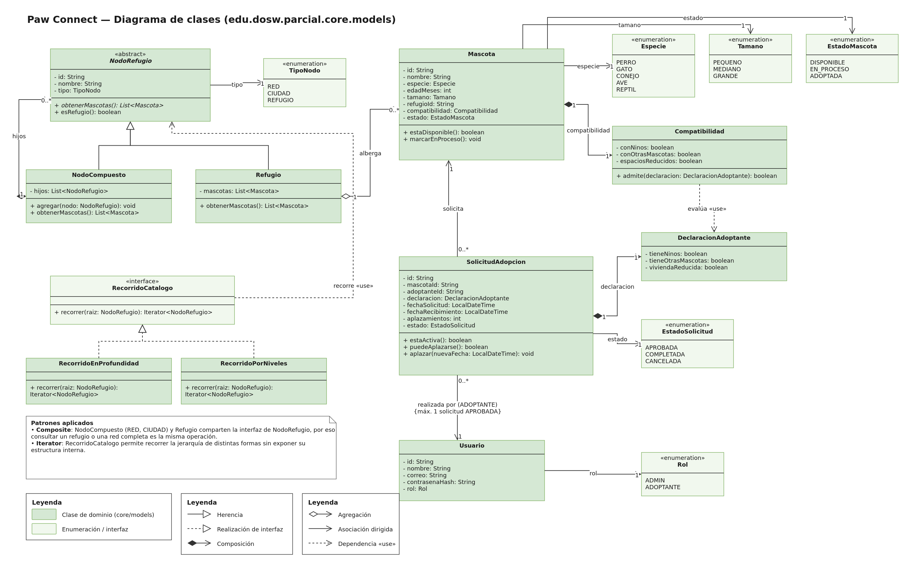

**Descripción.** Representa las clases del paquete core/models: la jerarquía de refugios, la mascota con su compatibilidad, la solicitud de adopción con la declaración del adoptante y el usuario con su rol, además de las enumeraciones que limitan los valores permitidos.

**Justificación.**
- Patrón Composite en la jerarquía de refugios. NodoRefugio es la abstracción común; NodoCompuesto representa la red nacional y las ciudades, y Refugio es la hoja que alberga mascotas. Como ambos responden a obtenerMascotas(), consultar un refugio individual o una red completa es la misma operación, tal como pide el contexto del sistema.
- Patrón Iterator con RecorridoCatalogo. Permite recorrer la jerarquía de distintas formas (en profundidad o por niveles) sin exponer cómo están organizados los nodos internamente.
- Enumeraciones (Especie, Tamano, EstadoMascota, EstadoSolicitud, Rol, TipoNodo) para que solo existan los valores definidos por Producto. En el código los identificadores se escriben sin tildes ni eñes (PEQUENO); en la API el valor se muestra como PEQUEÑO mediante @JsonValue.
- Objetos de valor Compatibilidad y DeclaracionAdoptante. Agrupan los tres criterios (niños, otras mascotas y espacios reducidos) y hacen que la comparación sea un solo método: Compatibilidad.admite(declaracion).
- Modelo con comportamiento. Las reglas que dependen solo del propio objeto viven en él: Mascota.estaDisponible(), SolicitudAdopcion.puedeAplazarse() y SolicitudAdopcion.aplazar(). Así no se repiten en varios servicios.
- SolicitudAdopcion guarda mascotaId y adoptanteId como referencias. La restricción "un adoptante solo puede tener una solicitud activa" se indica en la asociación con Usuario y se verifica en AdopcionService.

### Preguntas para la revisión con Arquitectura

#### ¿Qué problemas aparecen cuando no se separan correctamente las capas? Presenten un ejemplo del caso y expliquen cómo distribuyen sus responsabilidades.

Cuando las capas no se separan aparecen alto acoplamiento, duplicación de reglas y dificultad para probar o modificar el sistema.

**Ejemplo del caso.** Si AdopcionController consultara directamente MascotaRepository, verificara si la mascota está DISPONIBLE y guardara la solicitud, ocurriría lo siguiente:
- La regla de disponibilidad quedaría escrita en el controller. Si otro flujo la necesita, tendría que copiarse.
- Para probar la regla habría que levantar el servidor HTTP y la base de datos, en lugar de una prueba unitaria sencilla.
- Un cambio en la colección de MongoDB obligaría a modificar el controller, aunque el contrato de la API no haya cambiado.

**Cómo distribuimos las responsabilidades:**
- **Controller:** recibe la petición, valida el formato del DTO, lo convierte a dominio con el Mapper IN y devuelve la respuesta con el código HTTP correspondiente.
- **Service:** coordina el caso de uso y aplica las reglas de negocio, apoyándose en los validators.
- **Repository:** solo guarda y consulta información, sin decidir nada sobre el negocio.

#### ¿Qué diferencia existe entre un validador, una utilidad y un servicio? Ubiquen un ejemplo de cada uno en su diseño e indiquen su responsabilidad.

| Tipo | Qué hace | Ejemplo en el diseño | Responsabilidad |
|---|---|---|---|
| **Validador** | Comprueba que los datos o las reglas se cumplan y lanza una excepción si no es así. No guarda ni consulta información. | AdopcionValidator (core/validators) | Verificar que la declaración del adoptante sea compatible con la mascota, que la fecha de recibimiento esté entre 1 y 15 días y que la solicitud no tenga ya un aplazamiento. |
| **Utilidad** | Ofrece una operación genérica y reutilizable, sin reglas de negocio ni estado. | FechaUtils (core/utils) | Calcular los días entre dos fechas y obtener la fecha actual, para que los validadores no repitan ese cálculo. |
| **Servicio** | Coordina un caso de uso completo: obtiene los datos, invoca validadores, cambia estados y persiste. | AdopcionService (core/services) | Ejecutar Adoptar una mascota: buscar la mascota, comprobar que no haya otra solicitud activa, validar, crear la solicitud APROBADA y cambiar la mascota a EN_PROCESO. |

#### ¿Qué diferencia existe entre el Mapper IN y el Mapper OUT? Indiquen dónde se ubican y qué representaciones transforman cada uno.

- **Mapper IN** (controller/mappers, por ejemplo MascotaMapper): está en la frontera con el cliente. Convierte el DTO de entrada a objeto de dominio (MascotaRequest → Mascota) y el objeto de dominio a DTO de salida (Mascota → MascotaResponse). Es decir, se ocupa de las dos direcciones del lado HTTP.
- **Mapper OUT** (persistence/mappers, por ejemplo MascotaPersistenceMapper): está en la frontera con la base de datos. Convierte entre objeto de dominio y documento de MongoDB (Mascota ↔ MascotaDocument).

Gracias a esta separación, el controller nunca manipula un documento, el service nunca recibe un DTO, y un cambio en la forma de almacenar los datos no altera el contrato de la API.

#### Retomen las tres reglas clasificadas en el paso anterior: ¿en qué componente debe ejecutarse cada una y por qué?

| Regla (punto 1) | Tipo | Componente | Por qué |
|---|---|---|---|
| La edad de la mascota debe estar entre 0 y 360 meses. | Entrada | MascotaRequest (anotaciones @Min(0) y @Max(360)), validado con @Valid en MascotaController. El error lo construye GlobalExceptionHandler (400). | Solo depende del dato recibido. Se rechaza lo antes posible, sin llegar al service ni a la base de datos. |
| La mascota debe estar DISPONIBLE para adoptarse. | Negocio | AdopcionService, usando Mascota.estaDisponible() (409). | Requiere consultar el estado actual de la mascota en la base de datos, y esa coordinación le corresponde al service. |
| La nueva fecha del aplazamiento debe ser posterior a la actual y no superar 15 días adicionales. | Negocio | AdopcionValidator, invocado por AdopcionService (422). | En el punto 1 se clasificó como de entrada, pero su cumplimiento depende de la fecha ya registrada en la solicitud, que está guardada en la base de datos. Por eso se valida después de cargar la solicitud, junto con la regla de máximo un aplazamiento. |

## Punto 3: Asignación del equipo de Base de Datos - Diseño de la persistencia

### Diseño de la base de datos

Para Paw Connect se propone utilizar MongoDB, organizando la información en las colecciones refugios, mascotas y adopciones.

En refugios se guardará la información de los refugios y su jerarquía. En mascotas se almacenarán los datos de cada animal, incluyendo sus características y compatibilidades. En adopciones se guardarán las solicitudes y su información relacionada.

### Documentos embebidos y referencias

Se utilizarán documentos embebidos para almacenar las características y compatibilidades de las mascotas, ya que hacen parte de su información. Para relacionar los refugios, las mascotas y las adopciones se utilizarán referencias, evitando repetir información innecesariamente.

### Ventaja y desventaja

Una ventaja es que este diseño permite organizar la información y mantener separados los datos que se administran de manera independiente.

Una desventaja es que algunas consultas pueden necesitar acceder a varias colecciones para obtener toda la información relacionada.

### Diagrama de bases de datos no relacionales

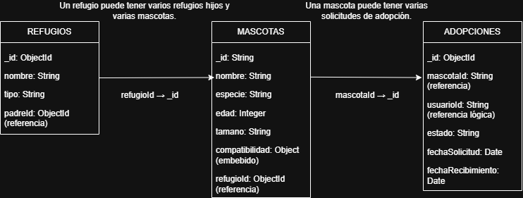

## Punto 4: Asignación del Equipo de Seguridad - Proteger el acceso y la información

#### ¿Cuál es la diferencia entre autenticación, autorización e integridad? Expliquen dónde y cómo aplicarán cada concepto en la API, con ejemplos del caso.

| Concepto | Pregunta que responde | Dónde se aplica | Ejemplo en Paw Connect |
|---|---|---|---|
| **Autenticación** | ¿Quién es el usuario? | AuthController y AuthService en el inicio de sesión; JwtAuthenticationFilter en cada petición posterior. | El usuario envía su correo y contraseña a POST /api/v1/auth/login. AuthService busca el usuario, compara la contraseña con el hash BCrypt guardado y, si coinciden, JwtService genera un token con su id y su rol. En las siguientes peticiones el filtro valida ese token; si falta o es inválido, la respuesta es 401. |
| **Autorización** | ¿Qué puede hacer ese usuario? | SecurityConfig (reglas por rol) y AdopcionService (verificación de propiedad). | Solo un ADMIN puede crear mascotas y solo un ADOPTANTE puede adoptar; si un ADOPTANTE intenta crear una mascota, recibe 403. Además, al aplazar, el servicio comprueba que la solicitud pertenezca al adoptante del token; si es de otra persona, también recibe 403. |
| **Integridad** | ¿La información llegó y se guardó sin alteraciones? | Firma del JWT, HTTPS y reglas de cambio de estado. | El token se firma con HMAC-SHA256 usando JWT_SECRET: si alguien modifica el rol dentro del token, la firma deja de coincidir y se rechaza. La comunicación con Azure y con MongoDB viaja cifrada (TLS). Además, si una adopción falla, no se crea la solicitud ni se cambia el estado de la mascota, de modo que los datos no quedan a medias. |

En resumen, la autenticación identifica, la autorización limita lo que esa identidad puede hacer y la integridad garantiza que ni el token ni los datos se modifiquen de forma indebida.

#### Seleccionen dos riesgos del OWASP Top 10 que se pueden encontrar en su API. Para cada uno, describan cómo se vería ese escenario aplicable a la barbería, su mitigación y cómo verificarían que el control funciona.

**A01:2021 – Pérdida de control de acceso (Broken Access Control)**

- **Escenario:** un adoptante autenticado cambia el identificador de la ruta en PATCH /api/v1/adopciones/{id}/aplazamiento y aplaza la solicitud de otra persona. Otro caso sería que un ADOPTANTE invoque POST /api/v1/mascotas, que es exclusivo del ADMIN.
- **Mitigación:**
  - Reglas por rol en SecurityConfig (o @PreAuthorize) para cada endpoint, siguiendo la matriz de códigos HTTP.
  - En AdopcionService, el adoptante se toma del token y nunca del cuerpo de la petición. Antes de aplazar se verifica que solicitud.adoptanteId sea igual al id del usuario autenticado.
  - Todo lo que no esté explícitamente permitido queda denegado (anyRequest().authenticated()).
- **Verificación:**
  - Prueba unitaria de AdopcionService: aplazar una solicitud de otro adoptante lanza la excepción de acceso denegado y el repositorio nunca guarda cambios (verify(repository, never()).save(any())).
  - Pruebas con MockMvc y @WithMockUser(roles = "ADOPTANTE"): crear una mascota responde 403; sin token, cualquier endpoint protegido responde 401.
  - Prueba manual en Swagger con los dos roles.

**A07:2021 – Fallas de identificación y autenticación (Identification and Authentication Failures)**

- **Escenario:** un atacante prueba muchas contraseñas contra el login. O bien obtiene un token que nunca vence, o se aprovecha de un mensaje de error que revela si un correo existe en el sistema.
- **Mitigación:**
  - Contraseñas guardadas con BCrypt, nunca en texto plano.
  - El token expira (jwt.expiration-ms: 3600000, es decir, una hora).
  - JWT_SECRET es un valor aleatorio de al menos 256 bits que se lee de una variable de entorno, no del código.
  - Mensaje de error genérico ("Credenciales inválidas") tanto si el correo no existe como si la contraseña es incorrecta.
  - Si el MVP crece, se puede agregar un límite de intentos de inicio de sesión.
- **Verificación:**
  - Pruebas unitarias de AuthService: un correo inexistente y una contraseña incorrecta producen el mismo error.
  - Pruebas de JwtService: un token vencido o con la firma alterada es rechazado.
  - Revisar el repositorio y el pipeline para confirmar que ningún secreto aparece en el código (solo en GitHub Secrets y en Azure).

#### ¿Cuál de los tipos de autenticación es el más adecuado para este MVP? Justifique su respuesta.

El más adecuado es la autenticación basada en tokens con JWT (Bearer token), por las siguientes razones:

1. **Es una API REST sin estado.** El servidor no guarda sesiones; cada petición trae su token con la identidad y el rol (STATELESS en SecurityConfig). Esto encaja con el despliegue en un contenedor de Azure App Service, que puede reiniciarse o escalar sin perder sesiones.
2. **Los roles viajan en el token.** El rol (ADMIN o ADOPTANTE) va dentro del token firmado, así que la autorización por endpoint no requiere consultar la base de datos en cada petición.
3. **Se ajusta a los usuarios del caso.** Los usuarios están predefinidos en la base de datos con correo y contraseña, por lo que un login propio que entregue un JWT es suficiente.
4. **Es práctico de usar y probar.** Swagger permite ingresar el token con el botón *Authorize*, como pide la parte práctica.

**Comparación con las alternativas:**
- **Basic Auth:** envía las credenciales en cada petición.
- **Sesiones con cookies:** exigen guardar estado en el servidor y son menos naturales para una API.
- **API Keys:** identifican aplicaciones, no usuarios con roles.
- **OAuth 2.0 / OpenID Connect con un proveedor externo:** es más robusto, pero agrega una complejidad que este MVP todavía no necesita.

## Punto 5: Asignación del Equipo de Calidad - Definir cómo comprobar el comportamiento

### Pruebas del caso de uso Adoptar una mascota

Para comprobar el funcionamiento de la adopción se deben probar tanto los casos exitosos como los casos en los que la solicitud debe ser rechazada. Se tendrán en cuenta las reglas de negocio definidas para el sistema.

### Se deben considerar los siguientes escenarios:

Adopción exitosa: la mascota está disponible, cumple las condiciones de compatibilidad, el adoptante no tiene otra solicitud activa y la fecha de recibimiento está dentro del rango permitido.

Mascota no disponible: la solicitud se rechaza y la mascota conserva su estado.

Adopción incompatible: se informa el motivo del rechazo y no se crea la solicitud.

Solicitud activa existente: no se permite crear otra solicitud activa para el mismo adoptante.

Fecha inválida: se rechaza la solicitud si la fecha de recibimiento no está entre 1 y 15 días a partir de la fecha actual.

### Aplicación de TDD

Se utilizará el enfoque TDD, que se divide en tres etapas:

Red: se escribe una prueba para comprobar una regla de negocio y se verifica que falle inicialmente.

Green: se implementa el código necesario para que la prueba pase.

Refactor: se mejora el código manteniendo el comportamiento esperado y asegurando que las pruebas continúen pasando.

Este proceso permite desarrollar las funcionalidades de manera progresiva y comprobar las reglas de negocio durante la implementación.

### Comprobación de la integridad de la información

Para comprobar que una adopción rechazada no afecta la información, se debe verificar que no se cree una nueva solicitud y que la mascota conserve su estado original. También se debe comprobar que una adopción exitosa cree la solicitud correspondiente y cambie el estado de la mascota a EN_PROCESO.

### Preguntas para la revisión con el equipo de Calidad

#### a. ¿Cómo aportan las pruebas evidencia del cumplimiento de las reglas de negocio?

Las pruebas permiten comprobar que el sistema se comporta como se espera ante diferentes situaciones. Las pruebas unitarias verifican reglas específicas, como la disponibilidad de la mascota, la compatibilidad del adoptante, la existencia de solicitudes activas y las fechas permitidas. También permiten comprobar que las operaciones rechazadas no produzcan cambios en la información.

#### b. ¿Las pruebas garantizan por sí solas la ausencia de errores?

No. Las pruebas permiten detectar errores en los escenarios evaluados, pero no garantizan que se hayan contemplado todas las situaciones posibles. Por eso es importante diseñar casos de prueba variados, cubrir las reglas de negocio y complementar las pruebas con revisiones del código y otras verificaciones.

## Punto 6: Asignación del Equipo de Devops - Definir cómo comprobar el comportamiento

Fuente del diagrama (draw.io): docs/uml/despliegue.drawio.

### Diagrama de despliegue

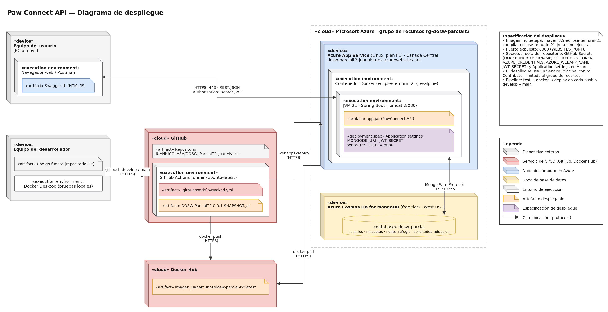

**Descripción.** Muestra dónde se ejecuta cada parte de la solución y cómo se comunican:

- **Equipo del usuario** («device»): consume la API desde un navegador (Swagger UI) o Postman, por **HTTPS en el puerto 443**, con el token JWT en el encabezado Authorization.
- **Azure App Service** («device», Linux, plan F1): ejecuta un contenedor Docker basado en eclipse-temurin:21-jre-alpine. Dentro, la JVM 21 ejecuta el artefacto app.jar (Spring Boot, puerto 8080).
- **Especificación del despliegue** («deployment spec»): las Application settings MONGODB_URI, JWT_SECRET y WEBSITES_PORT=8080, que configuran el contenedor sin incluir secretos en la imagen.
- **Azure Cosmos DB for MongoDB** («device»): contiene la base de datos dosw_parcial con sus cuatro colecciones. Se conecta mediante el protocolo de MongoDB sobre TLS (puerto 10255).
- **Cadena de entrega:**
  1. El desarrollador hace git push a GitHub.
  2. El runner de GitHub Actions compila, prueba y genera el .jar.
  3. El runner publica la imagen en Docker Hub (juanamunoz/dosw-parcial-t2:latest).
  4. El runner ordena el despliegue a Azure con un Service Principal.
  5. App Service descarga la imagen desde Docker Hub (docker pull).

**Justificación.**
- Se separan los nodos de cómputo (App Service) y de datos (Cosmos DB) para que cada uno pueda administrarse y escalar por su cuenta. La aplicación es un artefacto sin estado y toda la información persistente queda en MongoDB.
- Se usa una imagen Docker multietapa: la primera etapa compila con Maven y la segunda solo contiene el JRE y el .jar. Así la imagen final es más liviana y no incluye herramientas de compilación.
- Los secretos nunca forman parte del artefacto: en el pipeline viven en GitHub Secrets y en ejecución en las Application settings de Azure. Por eso la misma imagen sirve para cualquier ambiente.
- Toda comunicación externa viaja cifrada (HTTPS o TLS). El Service Principal solo tiene permisos sobre el grupo de recursos rg-dosw-parcialt2, según el principio de mínimo privilegio.
- Las regiones (Canada Central para la aplicación y West US 2 para la base de datos) corresponden a las permitidas por la suscripción Azure for Students y a la capacidad disponible al crear los recursos.

### Preguntas para la revisión con el equipo de Devops

#### ¿Cuáles son las etapas principales de un pipeline CI/CD y qué propósito tiene cada una?

| Etapa | Propósito | En nuestro pipeline (.github/workflows/ci-cd.yml) |
|---|---|---|
| **Disparo (trigger)** | Iniciar el proceso automáticamente cuando se integra código. | push a develop y main. |
| **Obtención del código y del entorno** | Descargar el código y preparar las herramientas con versiones fijas para que el resultado sea reproducible. | actions/checkout y actions/setup-java (Temurin 21, con caché de Maven). |
| **Compilación (build)** | Comprobar que el código compila con todas sus dependencias. | Job test: mvn verify. |
| **Pruebas** | Confirmar que las reglas de negocio se siguen cumpliendo y medir la cobertura. | Job test: pruebas con JUnit y Mockito, y reporte de JaCoCo. |
| **Análisis estático** | Detectar errores, vulnerabilidades y malas prácticas antes de desplegar. | SonarQube (sonar-maven-plugin), que se incorporará en la parte práctica. |
| **Empaquetado y publicación** | Generar un artefacto versionado e inmutable y dejarlo en un registro. | Job docker: construcción de la imagen y publicación en Docker Hub. |
| **Despliegue** | Poner la nueva versión en el ambiente de ejecución. | Job deploy: azure/webapps-deploy hacia App Service. |
| **Verificación** | Confirmar que la versión desplegada responde. | Consulta de /api/v1/health y de Swagger en la URL pública. |

Las etapas son secuenciales (needs: test y needs: docker), de modo que cada una solo se ejecuta si la anterior terminó bien.

#### ¿Qué sucede si una prueba falla? ¿Debe permitirse el despliegue? Justifique.

Si una prueba falla, mvn verify termina con error y el job test queda en rojo. Como docker y deploy dependen de él, no se construye la imagen ni se despliega, y el equipo ve en GitHub Actions qué prueba falló.

**No debe permitirse el despliegue**, por estas razones:
- Una prueba fallida es evidencia de que alguna regla no se cumple. Por ejemplo, podría permitirse adoptar una mascota que no está DISPONIBLE.
- Desplegar así llevaría el error a producción y podría dejar datos inconsistentes, que son más difíciles de corregir que el código.
- El pipeline funciona como una compuerta de calidad: se corrige la causa, se hace un nuevo push y el proceso se repite.

Una aclaración: el Dockerfile compila con -DskipTests. Esto no salta el control, porque las pruebas ya se ejecutaron en el job anterior y la imagen solo se construye si pasaron.

#### ¿Para qué sirven los logs y qué registrarían para investigar una reserva fallida o un error de autenticación?

Los logs permiten reconstruir lo que ocurrió en una operación cuando no se puede depurar en producción. Sirven para diagnosticar errores, auditar acciones sensibles (quién adoptó o aplazó) y detectar comportamientos anómalos, como muchos intentos de inicio de sesión fallidos. Se usan niveles según la gravedad: **INFO** para operaciones exitosas, **WARN** para rechazos esperados por reglas de negocio o de seguridad, **ERROR** para fallos inesperados y **DEBUG** para detalle durante el desarrollo.

*En el caso Paw Connect, la "reserva" corresponde a la solicitud de adopción.*

- **Solicitud de adopción fallida:**
  - Fecha y hora.
  - Nivel WARN.
  - Identificador de la petición (*traceId*).
  - Endpoint.
  - Id del adoptante (tomado del token) e id de la mascota.
  - Regla que se incumplió (por ejemplo MASCOTA_NO_DISPONIBLE, ADOPCION_INCOMPATIBLE, SOLICITUD_ACTIVA_EXISTENTE o FECHA_RECIBIMIENTO_INVALIDA).
  - Código HTTP devuelto.
  - Ejemplo: WARN [traceId=7f3a…] Adopción rechazada: adoptanteId=U-12, mascotaId=PERRO-002, motivo=ADOPCION_INCOMPATIBLE, status=422
- **Error de autenticación:**
  - Fecha y hora.
  - Nivel WARN.
  - *traceId*.
  - Endpoint.
  - IP de origen.
  - Motivo (credenciales inválidas, token vencido, firma inválida o token ausente).
  - Código 401 o 403.
  - Ejemplo: WARN [traceId=91bc…] Token rechazado: motivo=TOKEN_EXPIRADO, ruta=/api/v1/adopciones, ip=190.x.x.x, status=401

#### Presente ejemplos de información útil para rastrear la operación y de datos que no deben registrarse.

| Útil para rastrear la operación | No debe registrarse |
|---|---|
| *traceId* o identificador de la petición | Contraseñas, aunque sean incorrectas |
| Fecha, hora y duración de la operación | Tokens JWT completos o el encabezado Authorization |
| Endpoint y método HTTP | JWT_SECRET, MONGODB_URI con usuario y contraseña, tokens de Docker Hub o credenciales de Azure |
| Id del usuario y su rol (no su correo completo) | Correos completos u otros datos personales del adoptante |
| Id de la mascota y de la solicitud | La declaración personal completa del adoptante (si tiene niños, el tipo de vivienda) |
| Estado anterior y nuevo (DISPONIBLE → EN_PROCESO) | Cuerpos completos de petición o respuesta |
| Regla incumplida y código HTTP | Trazas de error en respuestas al cliente |
| Nombre de la excepción y traza completa (solo en ERROR, en el log interno) | — |

#### Que diferencia debe existir entre el detalle del log interno del mensaje que recibe el cliente.

- **Log interno:** es para el equipo de desarrollo y soporte. Debe ser detallado: tipo de excepción, traza completa, clase y método donde ocurrió, identificadores involucrados y la causa técnica (por ejemplo, el tiempo de espera agotado al conectar con MongoDB).
- **Mensaje al cliente:** debe ser claro y suficiente para corregir la petición, pero sin revelar detalles de la implementación. Incluye el código HTTP, un mensaje entendible, los campos inválidos cuando aplique y el mismo *traceId*, para que soporte pueda ubicar el registro interno.

Exponer trazas, nombres de clases o consultas facilitaría ataques, porque mostraría la tecnología y la estructura interna de la aplicación.

**Ejemplo para un error inesperado.**

Respuesta al cliente (500):

```json
{
  "timestamp": "2026-10-13T15:42:10Z",
  "status": 500,
  "error": "Error interno",
  "message": "No fue posible procesar la solicitud. Intente más tarde.",
  "path": "/api/v1/adopciones",
  "traceId": "7f3a2c91"
}
```

Log interno:

```
ERROR [traceId=7f3a2c91] AdopcionService.adoptar - MongoTimeoutException: Timed out after 30000 ms while waiting to connect ... (traza completa)
```

Para un error de negocio (por ejemplo 409, mascota no disponible), el cliente recibe un mensaje específico como *"La mascota no está disponible para adopción"*. El log interno registra además los ids y el estado actual de la mascota.
