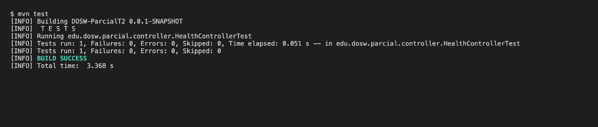
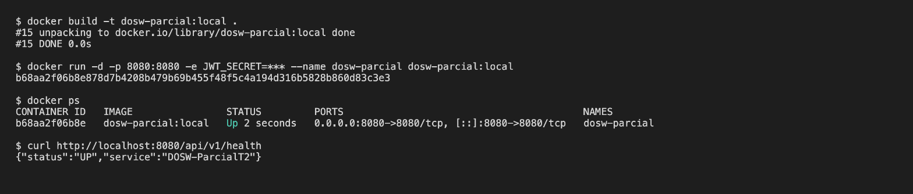

# DOSW_ParcialT2_JuanAlvarez

## Índice

1. [Datos del estudiante](#1-datos-del-estudiante)
2. [Descripción del proyecto](#2-descripción-del-proyecto)
3. [Despliegue](#3-despliegue)
4. [Estructura del proyecto](#4-estructura-del-proyecto)
5. [Tecnologías y dependencias](#5-tecnologías-y-dependencias)
6. [Configuración y variables de entorno](#6-configuración-y-variables-de-entorno)
7. [Cómo ejecutar](#7-cómo-ejecutar)
8. [Pruebas](#8-pruebas)
9. [Docker](#9-docker)
10. [CI/CD](#10-cicd)
11. [Herramientas de modelado y diseño (evidencias)](#11-herramientas-de-modelado-y-diseño-evidencias)

---

## 1. Datos del estudiante

| Campo | Valor |
|---|---|
| Nombre completo | Juan Nicolás Álvarez Muñoz |
| Grupo | 2 |
| Profesor agregado al repositorio | ✔ |

## 2. Descripción del proyecto

Servicio REST desarrollado con Spring Boot para el parcial práctico del segundo tercio de DOSW.
El proyecto sigue una arquitectura MVC por capas (controller, core y persistence), usa MongoDB como
base de datos, Spring Security con JWT para la autenticación y Swagger para documentar la API.
Se empaqueta en una imagen Docker y se despliega automáticamente en Azure App Service mediante GitHub Actions.

## 3. Despliegue

| Recurso | URL |
|---|---|
| Servicio en Azure | https://dosw-parcialt2-juanalvarez.azurewebsites.net |
| Health | https://dosw-parcialt2-juanalvarez.azurewebsites.net/api/v1/health |
| Swagger | https://dosw-parcialt2-juanalvarez.azurewebsites.net/swagger-ui/index.html |

## 4. Estructura del proyecto

```
DOSW_ParcialT2_JuanAlvarez/
├── docs/
│   ├── uml/
│   └── images/
├── src/
│   ├── main/
│   │   ├── java/edu/dosw/parcial/
│   │   │   ├── controller/
│   │   │   │   ├── dtos/
│   │   │   │   │   ├── request/
│   │   │   │   │   └── response/
│   │   │   │   ├── mappers/
│   │   │   │   └── handlers/
│   │   │   ├── core/
│   │   │   │   ├── services/
│   │   │   │   ├── models/
│   │   │   │   ├── validators/
│   │   │   │   └── utils/
│   │   │   ├── persistence/
│   │   │   │   ├── entities/
│   │   │   │   ├── repositories/
│   │   │   │   └── mappers/
│   │   │   ├── config/
│   │   │   └── main/
│   │   └── resources/
│   │       └── application.yaml
│   └── test/
│       ├── java/edu/dosw/parcial/
│       │   ├── controller/
│       │   ├── core/
│       │   └── persistence/
│       └── resources/
├── .github/workflows/ci-cd.yml
├── Dockerfile
├── .dockerignore
├── pom.xml
├── .gitignore
└── README.md
```

| Paquete / carpeta | Responsabilidad |
|---|---|
| `docs/uml` | Diagramas fuente (draw.io / Lucidchart / Miro). |
| `docs/images` | Exportes PNG/SVG y capturas usadas como evidencia en este README. |
| `controller` | Controladores REST que exponen los endpoints de la API. |
| `controller/dtos/request` | DTOs de entrada con sus validaciones. |
| `controller/dtos/response` | DTOs de salida que se devuelven al cliente. |
| `controller/mappers` | Mapper IN: RequestDTO → Dominio y Dominio → ResponseDTO. |
| `controller/handlers` | `GlobalExceptionHandler` para el manejo centralizado de errores. |
| `core/services` | Lógica de negocio. |
| `core/models` | Objetos de dominio. |
| `core/validators` | Reglas de validación del negocio. |
| `core/utils` | Utilidades compartidas. |
| `persistence/entities` | Clases `@Document` de MongoDB. |
| `persistence/repositories` | Interfaces `MongoRepository`. |
| `persistence/mappers` | Mapper OUT: Dominio ↔ Document. |
| `config` | Configuración de seguridad (`SecurityConfig`) y Swagger (`SwaggerConfig`). |
| `main` | Clase principal anotada con `@SpringBootApplication`. |

## 5. Tecnologías y dependencias

| Tecnología | Versión | Para qué se usa |
|---|---|---|
| Java | 21 | Lenguaje del proyecto. |
| Spring Boot | 3.5.16 | Framework base del servicio. |
| Spring Web | (Spring Boot) | Construcción de la API REST. |
| Spring Data MongoDB | (Spring Boot) | Persistencia en MongoDB. |
| Spring Validation | (Spring Boot) | Validación de DTOs. |
| Spring Security | (Spring Boot) | Seguridad de los endpoints. |
| JJWT | 0.12.7 | Generación y validación de tokens JWT. |
| springdoc-openapi | 2.8.17 | Documentación de la API con Swagger UI. |
| Lombok | (Spring Boot) | Reducción de código repetitivo y logs con `@Slf4j`. |
| MapStruct | 1.6.3 | Mappers entre DTOs, dominio y documentos. |
| JUnit 5 + Mockito | (Spring Boot) | Pruebas unitarias. |
| Jacoco | 0.8.15 | Reporte de cobertura de pruebas. |
| SonarQube (sonar-maven-plugin) | 5.8.0.7211 | Análisis estático de calidad del código. |
| Docker | — | Contenerización del servicio. |
| GitHub Actions | — | Pipeline de CI/CD. |
| Azure App Service | — | Despliegue del contenedor. |

## 6. Configuración y variables de entorno

| Variable | Descripción | Ejemplo |
|---|---|---|
| `MONGODB_URI` | Cadena de conexión a MongoDB. Si no se define se usa la base local. | `mongodb://localhost:27017/dosw_parcial` |
| `JWT_SECRET` | Secret en Base64 para firmar los JWT (mínimo 44 caracteres). | `<secret_base64>` |
| `PORT` | Puerto del servidor (por defecto 8080). | `8080` |
| `WEBSITES_PORT` | Puerto al que Azure enruta el tráfico del contenedor. | `8080` |

Ninguna credencial se sube al repositorio: `.env` y `*.p12` están en el `.gitignore`.

## 7. Cómo ejecutar

**Mongo local con Docker**

```bash
docker run -d -p 27017:27017 --name mongo-parcial mongo:7
```

**Local con Maven**

```bash
export JWT_SECRET=$(openssl rand -base64 48)
mvn spring-boot:run
```

**Local con Docker**

```bash
docker build -t dosw-parcial:local .
docker run -p 8080:8080 -e JWT_SECRET=<su_secret_base64> dosw-parcial:local
```

Luego abrir http://localhost:8080/api/v1/health y http://localhost:8080/swagger-ui/index.html.

## 8. Pruebas

```bash
mvn test
```

El reporte de cobertura de Jacoco queda en `target/site/jacoco/index.html`.

_Captura del resultado en verde:_

<!--  -->

_Captura del reporte Jacoco:_

<!--  -->

## 9. Docker

```bash
docker build -t dosw-parcial:local .
docker run -p 8080:8080 -e JWT_SECRET=<su_secret_base64> dosw-parcial:local
```

_Captura del contenedor corriendo:_

<!--  -->

## 10. CI/CD

El pipeline está en `.github/workflows/ci-cd.yml` y se ejecuta con cada push a `main` y `develop`:

1. **test**: compila el proyecto y ejecuta las pruebas con `mvn verify`.
2. **docker**: construye la imagen y la publica en Docker Hub (`<usuario>/dosw-parcial-t2:latest`).
3. **deploy**: despliega la imagen en Azure App Service.

Secrets usados: `DOCKERHUB_USERNAME`, `DOCKERHUB_TOKEN`, `AZURE_CREDENTIALS`, `AZURE_WEBAPP_NAME`, `JWT_SECRET`.

_Captura del workflow en verde:_

<!--  -->

## 11. Herramientas de modelado y diseño (evidencias)

_Captura de la cuenta en Lucidchart / Draw.io / Miro:_

<!--  -->

_Captura de la cuenta en Figma:_

<!--  -->
