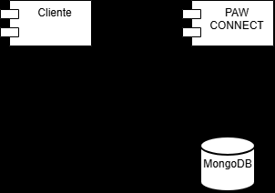
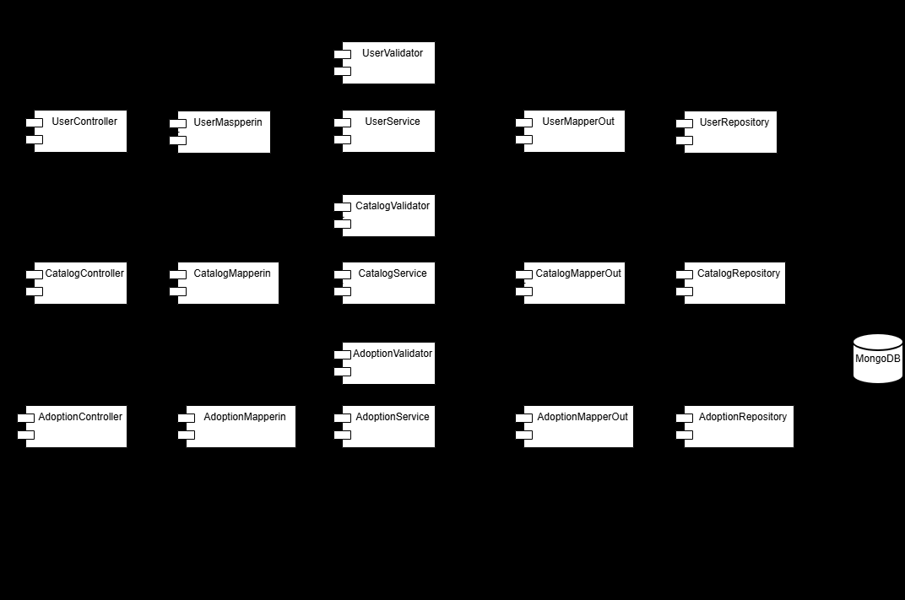
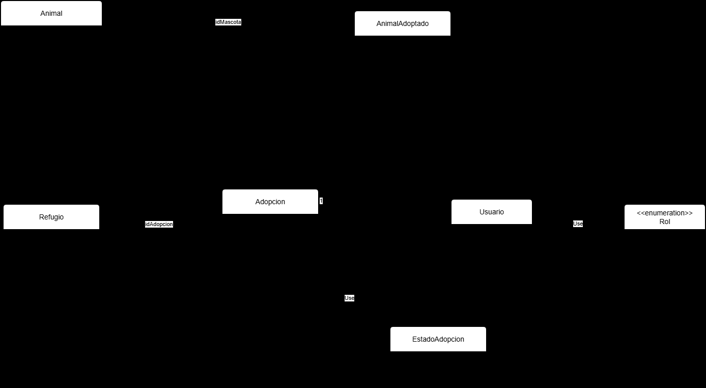

# DOSW_ParcialT2_JuanAlvarez

## Índice

1. [Datos del estudiante](#1-datos-del-estudiante)
2. [Descripción del proyecto](#2-descripción-del-proyecto)
3. [Despliegue](#3-despliegue)
4. [Estructura del proyecto](#4-estructura-del-proyecto)
5. [Tecnologías y dependencias](#5-tecnologías-y-dependencias)
6. [Configuración y variables de entorno](#6-configuración-y-variables-de-entorno)
7. [Cómo ejecutar](#7-cómo-ejecutar)
8. [Pruebas](#8-pruebas)
9. [Docker](#9-docker)
10. [CI/CD](#10-cicd)
11. [Herramientas de modelado y diseño (evidencias)](#11-herramientas-de-modelado-y-diseño-evidencias)

---

## 1. Datos del estudiante

| Campo | Valor |
|---|---|
| Nombre completo | Juan Nicolás Álvarez Muñoz |
| Grupo | 2 |
| Profesor agregado al repositorio | ✔ |

## 2. Descripción del proyecto

Servicio REST desarrollado con Spring Boot para el parcial práctico del segundo tercio de DOSW.
El proyecto sigue una arquitectura MVC por capas (controller, core y persistence), usa MongoDB como
base de datos, Spring Security con JWT para la autenticación y Swagger para documentar la API.
Se empaqueta en una imagen Docker y se despliega automáticamente en Azure App Service mediante GitHub Actions.

## 3. Despliegue

| Recurso | URL |
|---|---|
| Servicio en Azure | https://dosw-parcialt2-juanalvarez.azurewebsites.net |
| Health | https://dosw-parcialt2-juanalvarez.azurewebsites.net/api/v1/health |
| Swagger | https://dosw-parcialt2-juanalvarez.azurewebsites.net/swagger-ui/index.html |


## 4. Estructura del proyecto

```
DOSW_ParcialT2_JuanAlvarez/
├── docs/
│   ├── uml/
│   └── images/
├── src/
│   ├── main/
│   │   ├── java/edu/dosw/parcial/
│   │   │   ├── controller/
│   │   │   │   ├── dtos/
│   │   │   │   │   ├── request/
│   │   │   │   │   └── response/
│   │   │   │   ├── mappers/
│   │   │   │   └── handlers/
│   │   │   ├── core/
│   │   │   │   ├── services/
│   │   │   │   ├── models/
│   │   │   │   ├── validators/
│   │   │   │   └── utils/
│   │   │   ├── persistence/
│   │   │   │   ├── entities/
│   │   │   │   ├── repositories/
│   │   │   │   └── mappers/
│   │   │   ├── config/
│   │   │   └── main/
│   │   └── resources/
│   │       └── application.yaml
│   └── test/
│       ├── java/edu/dosw/parcial/
│       │   ├── controller/
│       │   ├── core/
│       │   └── persistence/
│       └── resources/
├── .github/workflows/ci-cd.yml
├── Dockerfile
├── .dockerignore
├── mvnw / mvnw.cmd / .mvn/
├── pom.xml
├── .gitignore
└── README.md
```

| Paquete / carpeta | Responsabilidad |
|---|---|
| `docs/uml` | Diagramas fuente (draw.io / Lucidchart / Miro). |
| `docs/images` | Exportes PNG/SVG y capturas usadas como evidencia en este README. |
| `controller` | Controladores REST que exponen los endpoints de la API. |
| `controller/dtos/request` | DTOs de entrada con sus validaciones. |
| `controller/dtos/response` | DTOs de salida que se devuelven al cliente. |
| `controller/mappers` | Mapper IN: RequestDTO → Dominio y Dominio → ResponseDTO. |
| `controller/handlers` | `GlobalExceptionHandler` para el manejo centralizado de errores. |
| `core/services` | Lógica de negocio. |
| `core/models` | Objetos de dominio. |
| `core/validators` | Reglas de validación del negocio. |
| `core/utils` | Utilidades compartidas. |
| `persistence/entities` | Clases `@Document` de MongoDB. |
| `persistence/repositories` | Interfaces `MongoRepository`. |
| `persistence/mappers` | Mapper OUT: Dominio ↔ Document. |
| `config` | Configuración de seguridad (`SecurityConfig`) y Swagger (`SwaggerConfig`). |
| `main` | Clase principal anotada con `@SpringBootApplication`. |

## 5. Tecnologías y dependencias

| Tecnología | Versión | Para qué se usa |
|---|---|---|
| Java | 21 | Lenguaje del proyecto. |
| Spring Boot | 3.5.16 | Framework base del servicio. |
| Spring Web | (Spring Boot) | Construcción de la API REST. |
| Spring Data MongoDB | (Spring Boot) | Persistencia en MongoDB. |
| Spring Validation | (Spring Boot) | Validación de DTOs. |
| Spring Security | (Spring Boot) | Seguridad de los endpoints. |
| JJWT | 0.12.7 | Generación y validación de tokens JWT. |
| springdoc-openapi | 2.8.17 | Documentación de la API con Swagger UI. |
| Lombok | (Spring Boot) | Reducción de código repetitivo y logs con `@Slf4j`. |
| MapStruct | 1.6.3 | Mappers entre DTOs, dominio y documentos. |
| JUnit 5 + Mockito | (Spring Boot) | Pruebas unitarias. |
| Jacoco | 0.8.15 | Reporte de cobertura de pruebas. |
| SonarQube (sonar-maven-plugin) | 5.8.0.7211 | Análisis estático de calidad del código. |
| Maven (Wrapper) | 3.9.11 | Construcción del proyecto sin instalar Maven (`mvnw`). |
| Docker | — | Contenerización del servicio. |
| GitHub Actions | — | Pipeline de CI/CD. |
| Azure App Service | — | Despliegue del contenedor. |

## 6. Configuración y variables de entorno

| Variable | Descripción | Ejemplo |
|---|---|---|
| `MONGODB_URI` | Cadena de conexión a MongoDB. Si no se define se usa la base local. | `mongodb://localhost:27017/dosw_parcial` |
| `JWT_SECRET` | Secret en Base64 para firmar los JWT (mínimo 44 caracteres). | `<secret_base64>` |
| `PORT` | Puerto del servidor (por defecto 8080). | `8080` |
| `WEBSITES_PORT` | Puerto al que Azure enruta el tráfico del contenedor. | `8080` |

Ninguna credencial se sube al repositorio: `.env` y `*.p12` están en el `.gitignore`.

## 7. Cómo ejecutar

### 7.1 Preparar el entorno en un PC nuevo

**Herramientas necesarias**

| Herramienta | Versión | Verificar con |
|---|---|---|
| Git | cualquiera reciente | `git --version` |
| JDK | **21** (Temurin recomendado) | `java -version` |
| Docker Desktop | cualquiera reciente | `docker --version` |
| IntelliJ IDEA (opcional) | cualquiera reciente | — |
| GitHub CLI (opcional) | cualquiera reciente | `gh --version` |

> ⚠️ **Usar JDK 21.** Con versiones más nuevas del JDK (por ejemplo 27) Lombok falla al compilar con
> `ExceptionInInitializerError: com.sun.tools.javac.tree.EndPosTable`. Si hay varios JDK instalados, `JAVA_HOME`
> debe apuntar al 21.

No hace falta instalar Maven: el proyecto incluye el Maven Wrapper (`mvnw` / `mvnw.cmd`), que descarga Maven 3.9.11 la primera vez.

**1. Clonar el repositorio y configurar la identidad de Git**

```bash
git clone https://github.com/JUANNICOLASA/DOSW_ParcialT2_JuanAlvarez.git
cd DOSW_ParcialT2_JuanAlvarez
git checkout develop
git config user.name "JUANNICOLASA"
git config user.email "juan.amunoz@mail.escuelaing.edu.co"
```

**2. Definir el secret JWT para desarrollo local**

En local se puede usar cualquier valor Base64 de mínimo 44 caracteres (no tiene que ser el de Azure).

macOS / Linux:

```bash
export JWT_SECRET=$(openssl rand -base64 48)
```

Windows (PowerShell):

```powershell
$bytes = New-Object byte[] 48; [Security.Cryptography.RandomNumberGenerator]::Create().GetBytes($bytes)
$env:JWT_SECRET = [Convert]::ToBase64String($bytes)
```

La variable solo dura mientras la terminal esté abierta.

**3. Levantar MongoDB local**

Con Docker Desktop abierto:

```bash
docker run -d -p 27017:27017 --name mongo-parcial mongo:7
```

Si el contenedor ya existe (por ejemplo, después de reiniciar el PC): `docker start mongo-parcial`.

**4. Compilar y ejecutar las pruebas**

```bash
./mvnw clean verify          # macOS / Linux
.\mvnw.cmd clean verify      # Windows
```

Debe terminar en `BUILD SUCCESS`. El reporte de Jacoco queda en `target/site/jacoco/index.html`.

**5. Ejecutar el servicio**

```bash
./mvnw spring-boot:run       # macOS / Linux
.\mvnw.cmd spring-boot:run   # Windows
```

Verificar en el navegador:

- http://localhost:8080/api/v1/health → `{"status":"UP","service":"DOSW-ParcialT2"}`
- http://localhost:8080/swagger-ui/index.html → carga Swagger

**6. Abrir el proyecto en IntelliJ IDEA**

1. *File → Open* y seleccionar el `pom.xml` → *Open as Project*.
2. *File → Project Structure → Project → SDK*: seleccionar **21** (si no aparece, *Add SDK → Download JDK → Temurin 21*).
3. *Settings → Build, Execution, Deployment → Compiler → Annotation Processors*: marcar **Enable annotation processing** (Lombok y MapStruct).
4. Instalar el plugin de **Lombok** si IntelliJ lo sugiere.
5. Abrir `src/main/java/edu/dosw/parcial/main/ParcialApplication.java`, ejecutarla una vez y luego en *Run → Edit Configurations → Environment variables* agregar `JWT_SECRET=<valor_base64>`.

**7. Verificar el despliegue y el pipeline**

No se necesita configurar nada de Azure ni de Docker Hub en el PC nuevo: los secrets ya están en GitHub y la configuración en el App Service.

1. Hacer un cambio, commit y push a `develop`:
   ```bash
   git add .
   git commit -m "mensaje"
   git push origin develop
   ```
2. Revisar en GitHub → *Actions* que el workflow **CI/CD — DOSW Parcial T2** quede en verde (test → docker → deploy).
3. Abrir https://dosw-parcialt2-juanalvarez.azurewebsites.net/api/v1/health y https://dosw-parcialt2-juanalvarez.azurewebsites.net/swagger-ui/index.html. La primera petición puede tardar 30–60 s si el servicio estaba inactivo (plan gratuito).

### 7.2 Comandos rápidos

**Mongo local con Docker**

```bash
docker run -d -p 27017:27017 --name mongo-parcial mongo:7
```

**Local con Maven**

```bash
export JWT_SECRET=$(openssl rand -base64 48)
./mvnw spring-boot:run
```

**Local con Docker**

```bash
docker build -t dosw-parcial:local .
docker run -p 8080:8080 -e JWT_SECRET=<su_secret_base64> dosw-parcial:local
```

Luego abrir http://localhost:8080/api/v1/health y http://localhost:8080/swagger-ui/index.html.

## 8. Pruebas

```bash
./mvnw test        # macOS / Linux
.\mvnw.cmd test    # Windows
```

El reporte de cobertura de Jacoco queda en `target/site/jacoco/index.html`.

_Captura del resultado en verde:_


_Captura del reporte Jacoco:_


## 9. Docker

```bash
docker build -t dosw-parcial:local .
docker run -p 8080:8080 -e JWT_SECRET=<su_secret_base64> dosw-parcial:local
```

_Captura del contenedor corriendo:_


## 10. CI/CD

El pipeline está en `.github/workflows/ci-cd.yml` y se ejecuta con cada push a `main` y `develop`:

1. **test**: compila el proyecto y ejecuta las pruebas con `mvn verify`.
2. **docker**: construye la imagen y la publica en Docker Hub (`<usuario>/dosw-parcial-t2:latest`).
3. **deploy**: despliega la imagen en Azure App Service.

Secrets usados: `DOCKERHUB_USERNAME`, `DOCKERHUB_TOKEN`, `AZURE_CREDENTIALS`, `AZURE_WEBAPP_NAME`, `JWT_SECRET`.

_Captura del workflow en verde:_


## 11. Herramientas de modelado y diseño (evidencias)

**Herramienta de modelado: Draw.io** (almacenamiento en Google Drive)


**Herramienta de diseño: Figma**


---

Solucion:

Punto 2:

**Diagrama de componentes general**



**Diagrama de componentes específico**



**Diagrama de clases**



**Preguntas:**

Preguntas para la revisión con Arquitectura:

¿Qué problemas aparecen cuando no se separan correctamente las capas? Presenten un ejemplo del caso y expliquen cómo distribuyen sus responsabilidades.

Alto acoplamiento, duplicación y dificultad para probar o modificar.

¿Qué diferencia existe entre un validador, una utilidad y un servicio? Ubiquen un ejemplo de cada uno en su diseño e indiquen su responsabilidad.

Validador: Comprueba que los datos o reglas se cumplan; por ejemplo, verificar que un correo tenga un formato válido.

Utilidad: Ofrece una operación genérica, reutilizable y normalmente sin lógica de negocio; por ejemplo, formatear una fecha.

Servicio: Coordina un caso de uso o implementa una capacidad del negocio; por ejemplo, registrar un usuario.

¿Qué diferencia existe entre el Mapper IN y el Mapper OUT? Indiquen dónde se ubican y qué representaciones transforman cada uno.

Mapper IN: Se ubica en la entrada de la aplicación y transforma datos externos como una solicitud HTTP en objetos que entiende el caso de uso.

Mapper OUT: Se ubica en la salida y transforma objetos internos en representaciones externas como entidades de base de datos o respuestas de una API.

Retomen las tres reglas clasificadas en el paso anterior: ¿en qué componente debe ejecutarse cada una y por qué? 

Formato o estructura → validador de entrada.

Regla propia del negocio → dominio o servicio.

Restricción dependiente de datos externos → adaptador o servicio de salida.